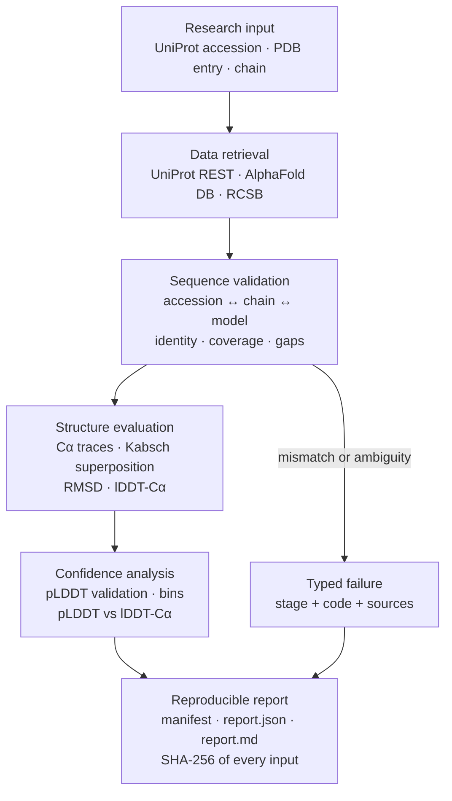

# NexusForge

**An evidence-first research engineering platform.** NexusForge turns a scientific
question into a reproducible, auditable computation instead of an unverifiable
claim.

**v0.1 — Protein Structure Confidence Explorer.** Give it a UniProt accession, a
PDB entry and a chain; it retrieves the real public data, *proves* that the
experimental chain corresponds to that protein, then reports Cα RMSD, lDDT-Cα and
pLDDT statistics with full provenance and explicit failure handling.

> Status: early but genuinely working. Everything marked **IMPLEMENTED** below
> was executed against live public APIs and is covered by tests. Everything
> marked **PLANNED** does not exist yet and is not claimed.

---

## Why this exists

Scientific software often fails silently: a mismatched chain, a stale model
version, a rescaled confidence vector. The pipeline is built around one rule:

> **A number is only reported if the identity of its inputs was verified and the
> computation actually ran.**

That rule is enforced in code, not in documentation:

* chain → UniProt correspondence is validated through the PDB entity
  cross-references *and* an independent sequence alignment;
* a failed run is written with `status: FAILED` and a typed error; it is never
  summarised as a success;
* metrics that were not computed are listed under `not_evaluated` with a reason;
* every fetched byte is hashed (SHA-256) and archived with its URL and UTC fetch
  time.

---

## Architecture



| Layer | Modules | Responsibility |
| --- | --- | --- |
| Data sources | `clients/uniprot.py`, `clients/alphafold.py`, `clients/rcsb.py` | Typed retrieval and parsing of three public APIs, including current-field handling and legacy-field fallbacks that are reported rather than guessed |
| Transport | `http.py` | Timeouts, bounded retries, `Retry-After`, 429/5xx handling, fast failure on 4xx, SHA-256 provenance |
| Science | `validation/sequence.py`, `validation/structure.py`, `validation/confidence.py` | Alignment and coverage, Cα extraction, rigid-body superposition, RMSD, lDDT-Cα, pLDDT validation and binning |
| Orchestration | `pipeline/protein_smoke.py` | Stage-scoped execution, check list, metrics assembly, failure attribution |
| Evidence | `reporting/` | `manifest.json`, `report.json`, `report.md`, `metrics.json`, run log |
| Interface | `cli.py` | `protein-smoke`, `doctor`, `version`, meaningful exit codes |

Detailed design notes: [docs/ARCHITECTURE.md](docs/ARCHITECTURE.md).

---

## Data sources (all public, no key required)

| Source | Endpoint used | What is retrieved |
| --- | --- | --- |
| UniProt REST | `https://rest.uniprot.org/uniprotkb/{accession}.json` | Reviewed entry, canonical sequence, protein/organism metadata |
| AlphaFold DB | `https://alphafold.ebi.ac.uk/api/prediction/{accession}` | Prediction record: model version, creation date, model-level pLDDT, file URLs |
| AlphaFold DB files | URLs *from the record* (`cifUrl`, `plddtDocUrl`, `paeDocUrl`) | mmCIF coordinates, per-residue confidence JSON, PAE JSON |
| RCSB data API | `https://data.rcsb.org/rest/v1/core/entry/{id}`, `.../polymer_entity/{id}/{n}` | Title, method, resolution, entity ↔ UniProt cross-reference, entity sequence |
| RCSB files | `https://files.rcsb.org/download/{id}.cif` | Experimental coordinates |

No file name or model version is hard-coded: structure and confidence URLs are
taken from the AlphaFold record itself, so a model version bump does not break
the pipeline. Two schema facts were verified against the live API on
2026-11-19 and are documented in [docs/DATA_SOURCES.md](docs/DATA_SOURCES.md):

* the current record still carries both `modelEntityId` and `entryId`; the
  parser prefers the former and records a note if it must fall back;
* the file endpoint returns **HTTP 403** for generic client identities, so the
  client sends a descriptive `User-Agent`.

---

## Scientific validation

### 1. Sequence correspondence (before any structural number)

The pipeline aligns the UniProt sequence against the AlphaFold model sequence
and against the PDB entity sequence using a deterministic global alignment
(BLOSUM-free affine-gap scoring). It reports identity, query/target coverage and
gap structure, and **stops** if identity or coverage fall below the configured
floors (`SEQUENCE_MISMATCH`). Ambiguity is a failure, not a guess: if one author
chain maps to more than one polymer entity, the run aborts with
`CHAIN_MAPPING_AMBIGUOUS`.

### 2. Structural agreement

* Cα atoms are extracted from both mmCIF files; residues without a Cα are
  reported, never imputed.
* Corresponding residues are matched through the UniProt reference frame.
* **RMSD** is computed after an optimal Kabsch superposition over matched Cα.
* **lDDT-Cα** is computed superposition-free: for every Cα pair closer than
  15 Å in the *experimental* structure, the distance difference is compared with
  the 0.5 / 1 / 2 / 4 Å thresholds; a residue score is the mean conserved
  fraction, and the global score is the mean over scored residues.

### 3. pLDDT ≠ lDDT

**pLDDT** is AlphaFold's per-residue prediction confidence. **lDDT-Cα** is a
distance test measured against an experimental reference. The report keeps them
in separate sections and relates them (bin means, Pearson/Spearman over residues
with both values) without ever equating them.

### Verified example (real execution)

Command, executed 2026-11-19 against the live APIs:

```bash
nexusforge protein-smoke --uniprot P69905 --pdb 4HHB --chain A --output runs/P69905-4HHB-A
```

| Result | Value |
| --- | --- |
| UniProt P69905 | Hemoglobin subunit alpha, *Homo sapiens*, reviewed, 142 aa |
| AlphaFold | `AF-P69905-F1`, model v6, created 2025-08-01, global pLDDT 98.06 |
| PDB 4HHB | 1.74 Å X-ray, entity 1 cross-referenced to P69905, chain A |
| Sequence identity | 100.00 % over aligned residues; coverage 99.30 %; 1 gap (initiator Met not resolved) |
| Mapped Cα | 141 |
| Cα RMSD | 0.335 Å |
| **lDDT-Cα** | **0.9921** (3 078 pairs within 15 Å) |
| pLDDT (142 residues) | mean 98.06, median 98.56, min 65.38, max 98.88 |
| Status | `SUCCESS`, reproducible run manifest with SHA-256 for all 9 responses |

A trimmed copy of that run is committed under
[examples/sample-run/](examples/sample-run/) (`report.md`, `metrics.json`,
`manifest.json`); the large raw downloads stay out of git.

---

## Installation

```bash
git clone <this repository>
cd NexusForge
python -m venv .venv && source .venv/bin/activate   # Python 3.11+
pip install -e ".[dev]"
```

---

## Usage

```bash
# Full pipeline + JSON/Markdown reports into runs/P69905-4HHB-A
nexusforge protein-smoke --uniprot P69905 --pdb 4HHB --chain A --output runs/P69905-4HHB-A

# Help and version
nexusforge --help
nexusforge version

# Check that the three data sources are reachable right now
nexusforge doctor
```

Exit codes (stable contract):

| Code | Meaning |
| --- | --- |
| 0 | success |
| 2 | invalid input (bad accession / PDB id / chain, or output dir not empty without `--force`) |
| 3 | data or validation failure (not found, sequence mismatch, invalid coordinates, confidence mismatch) |
| 4 | network or source failure (timeout, 429 exhausted, 5xx exhausted) |
| 5 | internal or reporting failure |

### Run artifacts

```
runs/P69905-4HHB-A/
├── manifest.json   # request, software versions, sources + SHA-256, checks, status
├── report.json     # machine-readable result (metrics, alignment, limitations)
├── report.md       # human-readable report, including what was NOT evaluated
├── metrics.json    # compact metric extract
├── raw/            # byte-identical API responses used by the run
└── logs/run.log    # every HTTP attempt, retry and decision
```

`runs/` is git-ignored: raw structures are large and regenerable from recorded
URLs and digests.

---

## Failure handling

Failures are typed, staged and reproducible. Every error carries an `ErrorCode`,
the `PipelineStage` (`data_retrieval`, `sequence_validation`,
`structure_parsing`, `structure_evaluation`, `confidence_evaluation`,
`reporting`), the source involved and structured details.

| Code | Raised when |
| --- | --- |
| `INVALID_INPUT` | Malformed accession, PDB id, chain, or unsafe overwrite |
| `SOURCE_NOT_FOUND` | 404/410 from a source, or a prediction/entity that does not exist |
| `SOURCE_UNAVAILABLE` | 401/403/5xx after bounded retries |
| `NETWORK_ERROR` | Timeouts or transport errors after bounded retries |
| `RATE_LIMITED` | 429 after bounded retries (`Retry-After` honoured, then capped) |
| `INVALID_API_RESPONSE` | Non-JSON body, empty body, missing required field, out-of-range pLDDT |
| `INVALID_SEQUENCE` | Non-amino-acid characters or empty sequence |
| `SEQUENCE_MISMATCH` | Identity/coverage below floor; chain maps to a different protein; chain is not polymeric |
| `CHAIN_MAPPING_AMBIGUOUS` | One author chain maps to several polymer entities |
| `NO_BASELINE` | Too few shared residues, or no Cα pairs inside the inclusion radius |
| `INVALID_COORDINATES` | Unparsable mmCIF, absent chain, non-finite mm coordinates, too few Cα |
| `CONFIDENCE_LENGTH_MISMATCH` | pLDDT count/numbering disagree with the modelled sequence |
| `REPORT_WRITE_FAILED` | An artifact could not be written, or the manifest was inconsistent |

Retry policy: bounded exponential backoff (deterministic, no jitter), 429 and
5xx retried, `Retry-After` honoured but capped, other 4xx fail immediately.
A failed run preserves everything already fetched so it can be diagnosed.

---

## Testing

```bash
pytest -q                     # offline suite: 103 passed, 1 skipped (live test)
NEXUSFORGE_LIVE=1 pytest -q -m network   # real-network smoke test (opt-in)
ruff check . && ruff format --check .
mypy
```

* **Unit tests** cover UniProt/AlphaFold/RCSB parsing on captured real responses,
  sequence alignment, Kabsch superposition, RMSD, lDDT-Cα, pLDDT validation,
  retry/backoff behaviour and report rendering.
* **Failure-injection tests** cover timeouts, 429 with `Retry-After`, 500s, 404s,
  empty bodies, invalid JSON, wrong chain, unknown chain, truncated pLDDT and
  out-of-range pLDDT — each asserting the run is *not* reported as success.
* **Offline integration tests** run the whole pipeline against gzipped fixtures
  captured from the live APIs (see `tests/fixtures/SHA256SUMS.txt`), and verify
  that every recorded artifact digest matches the bytes on disk.
* The **live test** is excluded from CI on purpose: third-party outages must not
  break the build.

---

## Status

### IMPLEMENTED (v0.1)

* UniProt, AlphaFold DB and RCSB retrieval with provenance and SHA-256.
* Current-schema AlphaFold parsing with reported legacy-field fallbacks.
* Sequence identity/coverage/gap validation with hard mismatch gates.
* Chain → entity → UniProt verification, including ambiguity refusal.
* Cα extraction, Kabsch superposition, RMSD, **lDDT-Cα** (Cα-only).
* pLDDT validation, cross-check against model B-factors, binning, correlation
  with per-residue lDDT-Cα.
* Aggregate PAE statistics when the record provides PAE.
* Reproducible run manifest, JSON/Markdown reports, run log, exit codes.
* 103 offline tests + 1 opt-in live test; Ruff and mypy clean; GitHub Actions CI
  passes on Python 3.11 and 3.12.

### IN PROGRESS

* All-atom lDDT (side-chain aware) — interface designed, not implemented.
* TM-score via a validated external aligner — deliberately not faked.
* Multi-model comparison across AlphaFold versions.

### PLANNED (not implemented — do not expect these)

* Multi-agent orchestration: literature mining agent, experiment-design agent,
  code-generation agent, evaluation agent.
* Automated experiment planning from a research question.
* Generated research applications and deployment/monitoring.
* Scientific paper drafting.

The long-term thesis is that the same evidence-first contract — verified inputs,
typed failures, hashed provenance, honest `not_evaluated` lists — is what makes
autonomous research agents trustworthy. v0.1 implements that contract for one
real scientific workflow before adding more agents.

---

## Limitations

* AlphaFold predictions are consumed **as published**; this project never runs
  the AlphaFold model.
* lDDT-Cα uses Cα atoms only; it is not comparable to full-atom lDDT.
* One experimental chain is compared; oligomeric context (e.g. the haemoglobin
  tetramer) is ignored.
* Only residues resolved in both structures are compared; unobserved residues
  are listed, not imputed.
* pLDDT is confidence, not measured accuracy; the reported correlation is an
  observation on one structure, not a calibration.

## Data licensing and citation

Data are retrieved at runtime from UniProt (CC BY 4.0), AlphaFold DB (CC BY 4.0)
and RCSB PDB (public domain/CC0). Please cite the original sources when reusing
results; this repository ships only small, attributed response fixtures under
`tests/fixtures/`. NexusForge itself is MIT licensed — see [LICENSE](LICENSE).
